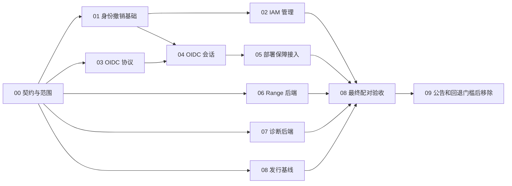

# OC 旧 Web 替代并行开发计划

本计划将剩余迁移拆为九个开发工作包和一个集成协调计划，供不同 agent 在独立分支/worktree 认领。目标基线为保留必要原生 IAM 与 OIDC/STS 能力的单实例集中控制台，再经正式发行、真实部署验收与弃用/回退窗口移除旧 Web。

计划日期为 2026-10-11。此前实现包括对象读写、配置、版本、ZIP/分享，以及独立原生 IAM 登录、改密、请求前验证和部分 IAM 管理。用户删除由 PR #32 提供；认领时重新核实其合并状态。此前补丁服务器验收不是正式发行组合认证；本次执行另有[正式发行配对基线](release-baseline.md)，其范围仍不包含未发行的新身份功能。

## 独立任务文件

- [共享契约与集成协调](00-contracts-and-integration.md)：集成协调者，计入各工作包，不另加开发估算。
- [身份影响范围与会话撤销基础](01-identity-and-revocation.md)：身份基础 agent，3–5 人日。
- [原生 IAM 管理能力补全](02-native-iam-management.md)：IAM 管理 agent，5–9 人日。
- [OIDC 和 STS 协议客户端](03-oidc-sts-protocol.md)：OIDC 协议 agent，5–9 人日。
- [OIDC 控制台登录与临时会话](04-oidc-console-sessions.md)：OIDC 会话 agent，5–9 人日。
- [集中部署 审计与稳定性](05-deployment-audit-and-stability.md)：部署保障 agent，8–14 人日。
- [Range 和条件下载](06-range-downloads.md)：下载协议 agent，3–5 人日。
- [诊断流与旧功能差异](07-diagnostics-and-feature-differences.md)：诊断 agent，3–5 人日。
- [正式发行与真实版本验收](08-release-and-compatibility.md)：发行验收 agent，6–10 人日。
- [默认关闭与旧 Web 移除](09-deprecation-and-removal.md)：服务端移除 agent，2–4 人日，不含日历等待。

[首批冻结契约](contracts-v1.md)给出实际基线、文件委派和协议边界。诊断范围已根据实际旧 Web 路由收窄为快照：日志/trace/profile/heal 是 CLI 功能，不再计为必需浏览器迁移缺口。原 40–70 人日为范围核实前的粗估，后续据验证结果重新估算。

## 首批并行分配

四个开发 agent 时，首批建议：03 OIDC 协议、06 Range、07 诊断后端、08 真实发行基线。集成协调者先完成 00 的接口和能力范围冻结；协调者不占独立开发 agent 名额时，可另启动 01。若协调者也算在四个可用名额内，开发并发上限是三个，08 可先由协调者兼任，避免超额。

03、06、07 在契约冻结前只做协议/差异调查与 fixture，不改共享类型或核心会话。01 完成后启动 02；03 和 01 稳定后由 04 独占核心登录接入窗口。05 可提前开发审计/部署模块，随后接入稳定会话。08 贯穿全程收集基线，最终验证集成版本。09 的实现最后启动。

## 文件拥有与集成规则

- 一个共享文件同一时刻只有一个拥有者。主 UI、公共类型和总文档归 00；核心会话先归 01，再交 04 独占接入。发行工作流和版本 pin 归 08。
- 后端 agent 新建自己的适配器、测试和验收脚本；给共享入口的改动作为接入补丁交给拥有者，不让多个分支各自大改 `server.go`、`app.js` 或公共 harness。
- 每个 agent 使用独立 worktree，禁止在同一个 checkout 并行切分支。新增 PR 从自己的工作分支发布；依赖未合并时标明依赖，不重复复制实现。
- 合并前核对基线、相关测试、真实权限负例和未知结果；集成后由 08 跑统一矩阵。单项 CI 通过不表示整个迁移已完成。
- 主体影响范围必须来自权威信息；OIDC email、浏览器目标字段不能成为跨身份授权依据。影响范围未知、协议缺失或关系竞争不安全时保持拒绝。

## 工作量与范围

01 与 02 合计 8–14 人日；03 与 04 合计 10–18 人日；05 为 8–14 人日；06 与 07 合计 6–10 人日；08 为 6–10 人日；09 为 2–4 人日，总计约 40–70 人日。00 的协调/接入成本已计入，不重复相加。

并行会缩短部分等待，不能把总人日直接除以 agent 数作为日历承诺。四路开发仍有契约、身份基础、登录接入和最终验收的串行路径。至少两个已通知发行周期与回退窗口另算，不能用短期连续发版代替真实迁移反馈。

多实例共享会话/撤销另加约 5–10 人日；目录登录或保留全部历史诊断能力也需单独估算。若改为限定原生 IAM/本机试部署并保留旧 Web 回退，另走约 3–6 人日的缩小范围方案，不构成删除授权。

## 可复制的 agent 任务

> 认领 OC 迁移计划中的一个工作包。先阅读 docs/console-parallel-plans/README.md、00-contracts-and-integration.md 和目标任务文件，确认依赖与文件拥有者，在独立 worktree 开发。按任务验收交付小 PR，记录真实版本/权限/失败证据。共享文件改动交指定拥有者集成，不改其他 agent 分支，不扩大支持范围或提前关闭/删除旧 Web。报告 PR、验证结果、未解决项和接入要求。

使用时附上具体任务文件，例如 `03-oidc-sts-protocol.md`。没有指定任务的 agent 先认领，不自行把九个包全部启动。计划文件本身不表示实现或发行已经完成；实际执行结果以独立 PR 与验收报告为准。
